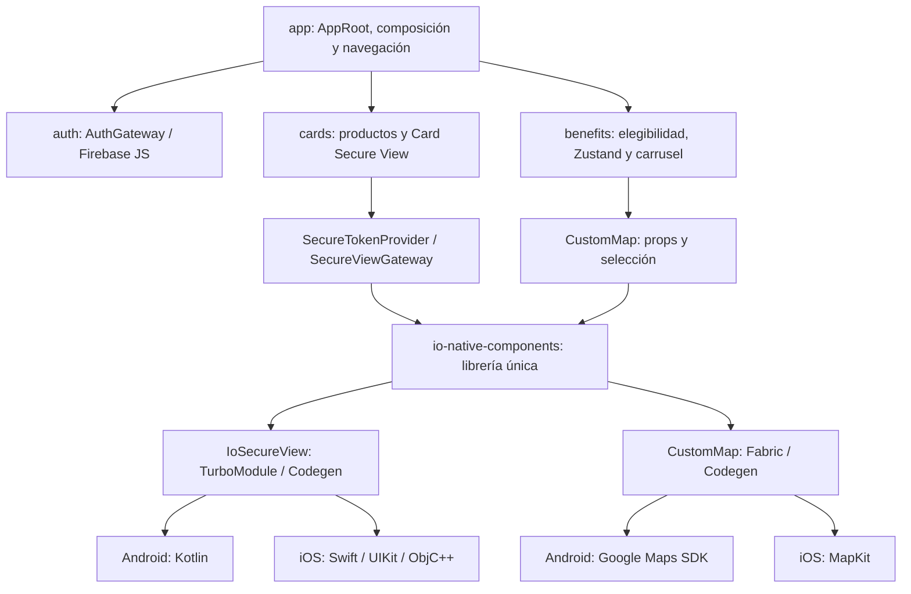
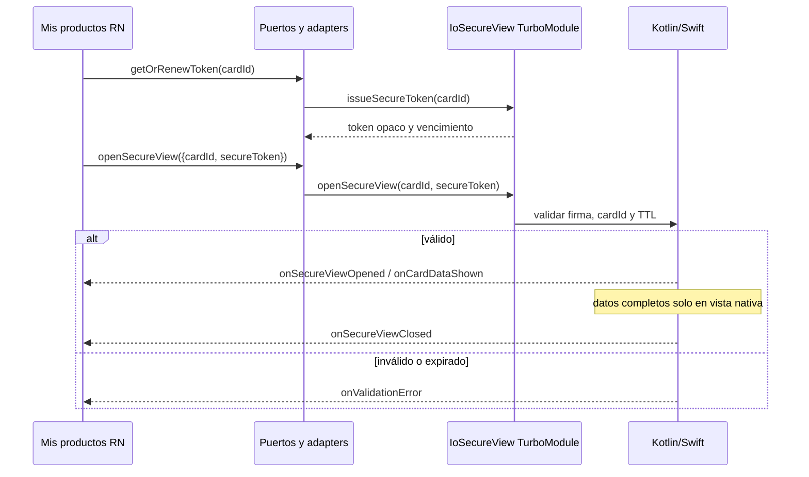

# iO Productos & Beneficios

App de demostración del reto Frontend iO para Android e iOS con React Native 0.88.0. El Dashboard ofrece **Mis productos** y **Beneficios**, protegido con Firebase Authentication Email/Password. La librería nativa propia única, `io-native-components`, implementa Card Secure View y CustomMap. Los datos financieros son sintéticos; esto no es un producto bancario listo para producción.

## Índice

1. [Alcance](#alcance)
2. [Tecnologías y versiones](#tecnologías-y-versiones)
3. [Requisitos](#requisitos)
4. [Instalación](#instalación)
5. [Google Maps Android](#google-maps-android)
6. [MapKit iOS](#mapkit-ios)
7. [Firebase](#firebase)
8. [Arquitectura](#arquitectura)
9. [Flujos RN y nativos](#flujos-rn-y-nativos)
10. [Estructura](#estructura)
11. [Mis productos](#mis-productos)
12. [Beneficios](#beneficios)
13. [API, Codegen y eventos](#api-codegen-y-eventos)
14. [Token mock](#token-mock)
15. [Seguridad](#seguridad)
16. [Pruebas y cobertura](#pruebas-y-cobertura)
17. [Decisiones](#decisiones)
18. [Diferencias y límites](#diferencias-y-límites)
19. [Entrega](#entrega)

## Alcance

La app muestra cuentas y tarjetas enmascaradas, una vista segura de datos completos sintéticos, beneficios aplicables en un mapa nativo y un carrusel sincronizado. El extra Auth añade login real con Firebase. Zustand mantiene selección y estado de presentación. No hay backend bancario, tarjetas reales ni autenticación bancaria.

## Tecnologías y versiones

| Componente | Versión/configuración verificada |
| --- | --- |
| React Native / React / TypeScript | 0.88.0 / 19.3.0 / 6.0.3 (`package.json`) |
| Firebase JS SDK / Zustand | 12.19.0 / 5.0.16 (`package.json`) |
| React Navigation native / bottom tabs | 7.5.1 / 7.21.0 (`package.json`) |
| Jest / React Native Testing Library | 29.6.3 / 14.1.0 (`package.json`) |
| Node | >=22.11.0 (`package.json`) |
| Android SDK min / compile / target | 24 / 37 / 36 (`android/build.gradle`) |
| Kotlin / Gradle wrapper | 2.2.0 / 9.4.1 (archivos Android) |
| iOS / Swift | deployment target 15.1 / Swift 5 (`ios/IoProductsBenefits.xcodeproj` y podspec) |

El Paso 11 usó Xcode 26.2 y iPhone 17 Pro Simulator con iOS 26.2; ese simulador exacto no es requisito. Android utiliza Kotlin y Google Maps SDK oficial. iOS utiliza Swift, Objective-C++, UIKit y MapKit oficial.
En el entorno de esta documentación se detectaron Node 22.23.4 (seleccionado), JDK 17.0.14, Xcode 26.2 y CocoaPods 1.17.0. Son versiones de referencia, no requisitos adicionales a los del toolchain.

## Requisitos

Node 22.11+, npm y red para dependencias, Firebase y mapas. Android: Android Studio, SDK/Build Tools compatibles, JDK compatible, `adb devices` con emulador/dispositivo online y Google Play services para Maps. iOS: macOS, Xcode/Command Line Tools, simulador disponible y CocoaPods. Las claves, servicios y cuenta demo deben configurarse por el propietario.

## Instalación

Desde la raíz:

```bash
node --version
npm --version
npm ci
npm run lint
npm run typecheck
npm run format:check
```

`npm ci` ejecuta `postinstall` y crea `firebaseConfig.ts` local vacío desde el ejemplo si falta. Si se instaló con `--ignore-scripts`, ejecutar `npm run postinstall`. Completar Firebase antes de esperar login real.

Android, con un emulador/dispositivo online:

```bash
adb devices
npm start
```

En otra terminal, desde la raíz: `npm run android`. Para solo compilar Debug: `cd android` y `./gradlew :app:assembleDebug`. Un build con la clave Maps placeholder no acredita teselas reales.

iOS, desde la raíz:

```bash
cd ios
pod install --no-repo-update
cd ..
npm start
```

En otra terminal: `npm run ios`. Como alternativa, abrir `ios/IoProductsBenefits.xcworkspace` en Xcode, elegir scheme `IoProductsBenefits` y un simulador, y ejecutar con Metro activo. El repositorio también incluye `Gemfile`; si se usa Bundler, instalar y ejecutar CocoaPods con ese entorno.

## Google Maps Android

`android/app/build.gradle` lee `android/local.defaults.properties` y luego `android/secrets.properties`. El archivo versionado contiene `MAPS_API_KEY=DEFAULT_API_KEY`, inválido a propósito. Crear localmente `android/secrets.properties` con la propiedad `MAPS_API_KEY`; está ignorado por Git. Habilitar Maps SDK for Android y restringir la clave al `applicationId` `com.ioproductsbenefits` y la huella de firma del build. Red, Play services o restricciones incorrectas pueden impedir las teselas. La configuración Release actual usa firma Debug: no se presenta como distribución de producción.

## MapKit iOS

CustomMap usa MapKit oficial. iOS no necesita clave Google Maps ni `GoogleService-Info.plist` para este diseño. Las teselas dependen de Apple y de la red.

## Firebase

Registrar una app web Firebase en el proyecto demo, habilitar Authentication → Email/Password y crear una cuenta demo remota. El SDK empleado es JavaScript, no Firebase Auth nativo. Copiar/completar localmente `src/capabilities/auth/infrastructure/firebase/firebaseConfig.ts.example` en `firebaseConfig.ts` con `apiKey`, `authDomain`, `projectId` y `appId`. `postinstall` hace la copia inicial cuando falta. El archivo real está ignorado por Git y su contenido no se documenta aquí. Entregar la cuenta y contraseña por canal privado del propietario.

`AppRoot` observa la sesión: sin sesión muestra Login, con sesión muestra Dashboard, y logout vuelve a Login. Credenciales inválidas generan un mensaje seguro. `FirebaseAuthGateway` usa `onAuthStateChanged`, `signInWithEmailAndPassword` y `signOut`. `inMemoryPersistence` requiere entrar de nuevo tras reiniciar el proceso. Sin configuración real la app puede compilar, pero no completar login. El ID token Firebase es independiente del `secureToken` de Card Secure View.

## Arquitectura

Vertical Slicing por `cards` (Cards / Account Management), `benefits` y `auth`; `app` compone dependencias, tema y navegación; `shared` contiene contratos comunes mínimos. En cada capability, `domain` modela datos y repositorios, `application` define puertos/casos de uso, `infrastructure` implementa adapters y `presentation` muestra UI. Benefits consume `AvailableCardBrandsReader` sin depender de detalles internos de Cards. Puertos pequeños separan lógica de SDKs, sin contenedor DI adicional.



## Flujos RN y nativos



Benefits obtiene marcas seguras con `AvailableCardBrandsReader`, intersecta `applicableBrands`, convierte `Benefit.id: number` a `MapMarker.id: string` y entrega marcadores a Fabric. `selectedBenefitId` está una sola vez en Zustand: tap en mapa selecciona carrusel y scroll asentado selecciona marcador. La selección programática no crea otro tap; `onMarkerPress(markerId)` valida el ID.

## Estructura

| Ruta | Función |
| --- | --- |
| `src/app` | Composición, compuerta Auth, navegación, tema |
| `src/capabilities/cards` | Productos, puertos, adapters y UI |
| `src/capabilities/benefits` | Repositorio mock, elegibilidad, mapa/carrusel |
| `src/capabilities/auth` | Gateway, Firebase y Login |
| `src/shared` | Tipos compartidos |
| `packages/io-native-components/src/specs` | Specs Codegen TurboModule y Fabric |
| `packages/io-native-components/android` | Kotlin, Google Maps, Card Secure View y JUnit |
| `packages/io-native-components/ios` | Swift/ObjC++, MapKit y Card Secure View |
| `ios/IoProductsBenefitsTests` | XCTest |
| `docs/steps` | Decisiones y cierres históricos |

`io-native-components` es dependencia local `file:./packages/io-native-components`; no se publicó en un registry.

## Mis productos

RN presenta cuentas/tarjetas enmascaradas y vencimiento MM/AA. «Ver datos sensibles» solicita un token mock nativo y abre la vista segura. PAN, CVV y titular completos **sintéticos** se obtienen y renderizan solo en Kotlin/Swift después de validar el token; no pasan a props, eventos, Zustand ni logs JS.

## Beneficios

El catálogo ficticio está en `src/capabilities/benefits/infrastructure/mocks/benefits.json`. `loadEligibleBenefits` intersecta `applicableBrands` con marcas disponibles, normaliza mayúsculas y descarta coordenadas inválidas. Si todas las elegibles carecen de ubicación válida, muestra error; si algunas se omiten, informa al usuario. Hay carga, vacío, error/reintento y alternativa textual accesible. El mapa y carrusel comparten selección; iOS añade controles de zoom MapKit.

## API, Codegen y eventos

Puertos de Cards: `SecureTokenProvider.getOrRenewToken(cardId): Promise<SecureToken>`, `SecureViewGateway.openSecureView({cardId, secureToken}): Promise<void>` y `subscribe(listener): () => void`. `SecureToken` contiene valor opaco y `expiresAtEpochMs`. `AuthGateway` expone `observeSession`, `signIn` y `signOut`. `CustomMapProps` de aplicación tiene `markers: readonly MapMarker[]`, `selectedMarkerId?: string | null` y `onMarkerPress(markerId: string)`; `MapMarker` lleva `id`, coordenadas y `title?`.

El paquete exporta `NativeIoSecureView` y `CustomMap`. La spec TurboModule define `issueSecureToken(cardId): Promise<IssuedTokenPayload>` y `openSecureView(cardId, secureToken): Promise<boolean>`. CustomMap es Fabric; su wrapper también admite `onStatus('loaded' | 'unavailable')` a través de `onMapStatus` nativo. Este último informa disponibilidad, no selección.

Pseudocódigo ilustrativo de los puertos de aplicación (instancias inyectadas), con un ID ficticio y sin publicar un token válido:

```ts
const cardId = 'card-demo';
const token = await secureTokenProvider.getOrRenewToken(cardId);
await secureViewGateway.openSecureView({cardId, secureToken: token.value});
const unsubscribe = secureViewGateway.subscribe(event => {
  // El evento contiene solo IDs, códigos o motivos permitidos.
  handleSafeEvent(event);
});
// Al desmontar la pantalla: unsubscribe();
```

Para el mapa, el wrapper acepta `markers`, `selectedMarkerId` y `onMarkerPress`; un marcador de ejemplo puede ser `{id: 'benefit-demo', latitude: -12.1, longitude: -77.0}` con coordenadas ficticias. La aplicación usa el mapper real de Benefits para construir esos valores.

| Evento contractual | Payload permitido |
| --- | --- |
| `onSecureViewOpened` | `cardId` |
| `onValidationError` | `code`, `message` seguros; `TOKEN_INVALID` o `TOKEN_EXPIRED` |
| `onCardDataShown` | `cardId`, sin campos completos |
| `onSecureViewClosed` | `cardId`, `reason`: `USER_DISMISS` o `TIMEOUT` |
| `onMarkerPress` | `markerId` validado |

Un error de validación no exige cierre automático: la vista permanece neutra, con Ocultar y timeout, sin contenido sensible. Ver [puerto de Cards](src/capabilities/cards/application/ports/SecureViewGateway.ts), [spec TurboModule](packages/io-native-components/src/specs/NativeIoSecureView.ts), [contrato mapa](src/capabilities/benefits/presentation/contracts/CustomMapContracts.ts) y [spec Fabric](packages/io-native-components/src/specs/CustomMapNativeComponent.ts).

## Token mock

Emitido y firmado en nativo con `v1.base64url(payload).base64url(HMAC-SHA256)` y clave efímera por proceso. Payload: longitud ID de 32 bits, ID UTF-8, emisión/vencimiento de 64 bits big endian y nonce de 16 bytes. Se validan integridad, formato, `cardId` y TTL. **Token: 60 s desde emisión. Sesión de vista: 45 s desde apertura.** Son relojes diferentes. En background se oculta/revalida; al vencer se cierra. El token opaco puede cruzar JS, pero no es ID token Firebase ni credencial bancaria. No ofrece garantía productiva contra replay o compromiso del proceso.

## Seguridad

| Control | Android | iOS | Límite |
| --- | --- | --- | --- |
| Datos completos sintéticos | Solo Kotlin | Solo Swift | Nunca JS |
| Screenshot | `FLAG_SECURE` en ventana sensible | Ocultamiento y notificaciones públicas | iOS no garantiza bloquear la primera captura de datos visibles |
| Background | Ocultamiento | Limpieza/ocultamiento en pérdida de actividad/escena | Mecanismos diferentes |
| Grabación | Protección de ventana | Reacción al aviso del sistema | Aviso de screenshot puede ser posterior |
| Cierre/tiempo | Ocultar / 45 s | Ocultar / 45 s | Timer nativo |
| Token mock | TTL 60 s | TTL 60 s | Claves independientes por proceso |

El Paso 11 validó iOS en simulador; iPhone físico fue omitido por el propietario. No se afirma resistencia a root/jailbreak/instrumentación ni certificación PCI/EMV.

Para verificar estos controles en una instalación de prueba:

1. Ejecutar `npm run test:native:android` y, en Xcode, `⌘U` sobre `IoProductsBenefitsTests` para comprobar los casos nativos de token, sesión y mapa.
2. Abrir «Ver datos sensibles» y comprobar el cierre manual y el timeout de 45 s. En Android, intentar una captura mientras la vista está abierta para verificar `FLAG_SECURE`. En iOS, pasar la app a segundo plano y volver para comprobar el ocultamiento; la primera captura visible no se puede bloquear de forma garantizada.
3. Comprobar que `android/secrets.properties` y `src/capabilities/auth/infrastructure/firebase/firebaseConfig.ts` permanecen fuera de Git con `git check-ignore -v android/secrets.properties src/capabilities/auth/infrastructure/firebase/firebaseConfig.ts` y `git ls-files` sobre esas rutas. No incluir contraseñas demo ni claves reales en capturas, logs o commits.

## Pruebas y cobertura

`npm test` es la entrada única para Jest/RNTL. Comandos vigentes:

```bash
npm test
npm test -- --watch=false --runInBand
npm test -- --watch=false --runInBand --coverage
npm run test:native:android
npm run test:all
npm run lint
npm run typecheck
npm run format:check
```

`test:all` encadena Jest y JUnit Android, sin XCTest. Para XCTest, abrir `ios/IoProductsBenefits.xcworkspace` en Xcode y ejecutar `⌘U` con scheme `IoProductsBenefits` / target `IoProductsBenefitsTests`. Es el método probado en Paso 11; no se atribuye un `xcodebuild test` no ejecutado.

Para consultar los resultados y guardar capturas de evidencia:

| Evidencia | Dónde verla tras ejecutar la prueba |
| --- | --- |
| Pruebas Jest | Resumen `Test Suites` y `Tests` al final de la terminal tras `npm test -- --watch=false --runInBand --coverage` |
| Cobertura React Native | Abrir `coverage/index.html`, generado por el mismo comando; la fila `All files` muestra el total |
| Pruebas JUnit Android | Abrir `packages/io-native-components/android/build/reports/tests/testDebugUnitTest/index.html` tras `npm run test:native:android` |
| Pruebas XCTest iOS | En Xcode, abrir el navegador de reportes con `⌘9` y seleccionar la ejecución `Test – IoProductsBenefits` más reciente tras `⌘U` |

`coverage/` y los reportes de build se generan localmente y están ignorados por Git. Si Gradle indica `UP-TO-DATE`, el HTML de JUnit corresponde a la última ejecución efectiva; para forzar una ejecución nueva: `cd android && ./gradlew :io-native-components:testDebugUnitTest --rerun-tasks`.

| Fuente histórica | Resultado |
| --- | --- |
| Paso 07, sección 25.8, 05/11/2026 | 65/65 DoD; 106 Jest/11 suites, 13 JUnit |
| Paso 09, sección 13.14, 06/11/2026 | 113 Jest/13 suites, 13 JUnit; cobertura RN: 96,32 % statements, 93,93 % branches, 96,25 % functions y 96,79 % lines; 44/44 archivos RN/TS instrumentables |
| Paso 11, sección 16, 06/11/2026 | 24/24 DoD; 113/113 Jest, 13/13 JUnit, 5/5 XCTest; build y smoke Android/iOS simulador con evidencia de herramientas y confirmación del propietario |

La cobertura numérica es **histórica del Paso 09**. El 70 % RN del enunciado es recomendado; JUnit/XCTest no se agregan a Istanbul. Las [ejecuciones de este paso](docs/delivery/TESTING-AND-EVIDENCE.md) se registran por separado.

## Decisiones

| Decisión | Motivo | Límite |
| --- | --- | --- |
| New Architecture + Codegen | TurboModule/Fabric tipados | Binding nativo más laborioso |
| Una librería local | Frontera y reutilización | No publicada |
| Maps oficiales Android/iOS | Integración nativa | Configuración y OS diferentes |
| Vertical Slicing + puertos | Capabilities aisladas y testeables | Adapters explícitos |
| Datos/token mock | Reproducción sin datos reales | Sin backend financiero |
| Firebase JS + memoria | Auth remota sin SDK nativo | Login tras reinicio |
| Carrusel RN + mapa Fabric | Selección compartida | Sin benchmark FPS/memoria |

## Diferencias y límites

Android requiere clave Maps local, Play services y Gradle/JUnit; iOS usa MapKit y Xcode/CocoaPods/XCTest. Ambos usan Codegen y Card Secure View nativo, con protecciones de captura diferentes. Mapas y Firebase dependen de red. No se han acreditado benchmarks de FPS/memoria ni prueba en iPhone físico. La firma Release Android usa actualmente debug keystore, por lo que requiere configuración de distribución antes de uso productivo. El Paso 08 sigue omitido y el 12 no ha comenzado.

## Entrega

El repo debe contener app Android/iOS, la librería propia, tests, cobertura documentada y este README. La [evidencia de pruebas](docs/delivery/TESTING-AND-EVIDENCE.md) separa resultados actuales e históricos. El [borrador de correo del Paso 10](docs/steps/STEP-10-DOCUMENTATION-DELIVERY.md#113-borrador-de-correo--asunto-literal-del-pdf) incluye el asunto exigido por el PDF y los datos que completará el propietario. Antes de compartir el repositorio, revisar el historial Git y los permisos de acceso; no incluir contraseñas, tokens ni claves reales.
