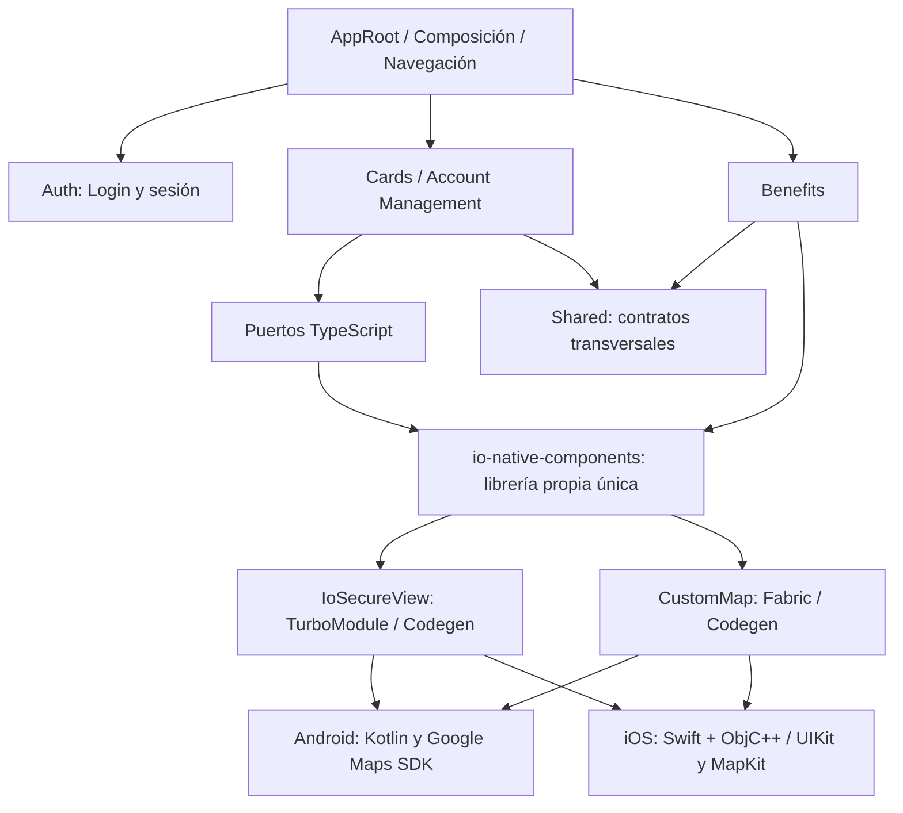
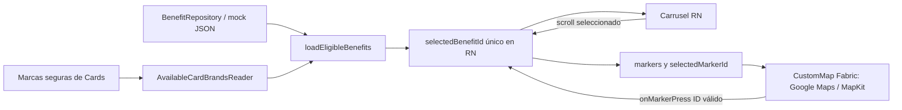

# STEP-10 — Documentación definitiva y preparación de entrega BCP

**Proyecto:** `io-products-benefits`  
**Aplicación:** iO Productos & Beneficios  
**Librería nativa única:** `io-native-components` (`packages/io-native-components/`)  
**Etapa:** 10 de 12 (ejecutada después de la 11 por decisión del propietario)  
**Estado de este documento:** **PROPUESTA PARA REVISIÓN Y APROBACIÓN — NO EJECUTADO**  
**Fecha de preparación:** 06/11/2026  
**Stack fijo:** React Native **0.88.0**, TypeScript estricto, New Architecture, TurboModule + Fabric + Codegen, Kotlin/Android y Swift/iOS  
**Documento normativo:** `Reto técnico - Chapter Master Frontend.pdf`  
**Documento rector:** `RETO_BCP_TECHNICAL_BASELINE.md`

> **Importante — Alcance del video:** el enunciado del BCP exige un video demostrativo, pero **su producción, guion, grabación, edición, revisión y entrega son responsabilidad exclusiva del propietario**. **El implementador no debe crear guiones, checklists de grabación, videos, capturas ni scripts de video**. El video no es un entregable ni un DoD de ejecución de este Paso 10. La comprobación humana de que se adjunte al envío corresponde al propietario y queda fuera del trabajo delegado. **El PDF no fija una duración del video.**
>
> **Autorización:** este archivo se prepara ahora únicamente para revisión. **No ejecutar el prompt, no modificar el checkout y no publicar nada hasta autorización explícita del propietario.**

---

## 0. Dictamen de alcance y fuentes

### 0.1. Dictamen

La base funcional **documentada** satisface el alcance principal exigido por el PDF: Dashboard con dos tabs; cuentas y tarjetas enmascaradas; Card Secure View y eventos nativos; mapa con beneficios aplicables y carrusel bidireccional; **una sola librería propia**. Los extras seleccionados incluyen Firebase Authentication real y paridad nativa Android/iOS. La documentación definitiva y la preparación controlada del repositorio son las acciones pendientes del **Paso 10**.

**No se ha inspeccionado aquí un checkout Git actual del repositorio**, ni se han ejecutado nuevos builds, tests o comandos. El documento toma como base el enunciado y los cierres de etapas existentes; **el implementador tendrá que cotejar únicamente los datos destinados al README con las fuentes efectivas del repo**, sin reauditar los DoD cerrados.

### 0.2. Orden de autoridad

1. **PDF oficial** para las exigencias de evaluación y entrega.
2. `RETO_BCP_TECHNICAL_BASELINE.md` para decisiones internas compatibles.
3. Contratos públicos **realmente aprobados y presentes** en el checkout, y cierre definitivo de cada paso.
4. Este documento del Paso 10.
5. Preferencias de formato del implementador.

Si un ejemplo de este documento difiere del código aprobado, **documentar el contrato y comando reales**, registrar el desfase y **no cambiar la implementación por comodidad documental**. Si una discrepancia afectara un requisito obligatorio del PDF, explicarla y detener los cambios invasivos para decisión del propietario.

### 0.3. Fuentes precisas y estados vigentes

| Fuente | Uso preciso | Estado que manda |
| --- | --- | --- |
| PDF oficial, pp. 1–2 | Plataforma obligatoria, UI, datos nativos, README | Requisito externo |
| PDF oficial, pp. 3–5 | Estructura de una librería, props de `CustomMap`, Secure View y eventos, diagrama del flujo esperado | Requisito externo |
| PDF oficial, pp. 6–7 | Pruebas unitarias, `--coverage`, 70 % **recomendado**, extras, criterios de evaluación | Requisito externo |
| PDF oficial, pp. 8–9 | Restricciones y entrega por correo; sustentación posterior | Requisito externo |
| `RETO_BCP_TECHNICAL_BASELINE.md` | Identidad, arquitectura, límites de datos, plan | Norma interna |
| `STEP-02-ARCHITECTURE.md` | Puertos `SecureTokenProvider`, `SecureViewGateway`, modelos, contrato `CustomMap` | Contratos aprobados, no redefinir |
| `STEP-04-NATIVE-SECURE-VIEW.md` | Módulo `IoSecureView`, HMAC mock, TTL **60 s**, sesión **45 s**, eventos y seguridad Android | Decisiones y comportamiento previos |
| `STEP-05-BENEFITS-CUSTOM-MAP.md`, §21.9 | Elegibilidad, mapa Android, librería Fabric, configuración de Google Maps | Cierre del Paso 05 |
| `STEP-06-MAP-CAROUSEL-SYNC.md`, §24.14 | Fuente de verdad `selectedBenefitId`, mapa ↔ carrusel; TalkBack manual excluido expresamente | Cierre del Paso 06 |
| `STEP-07-TESTING-COVERAGE.md`, §25.8 | Cierre 65/65, test nativo y cobertura RN auditada | **Histórico** del Paso 07 |
| `STEP-09-EXTRAS.md`, §13.14 | Firebase Email/Password, credenciales locales, login real Android, cierre 12/12 | **Histórico** del Paso 09 |
| `STEP-11-IOS-SWIFT-MAPKIT.md`, §16.1–§16.9 | **Cierre 24/24**; Swift/MapKit, XCTest y validación de simulador; riesgos de screenshots iOS | Cierre definitivo del Paso 11 |
| Checkout real al ejecutar | Versiones exactas, rutas, scripts, output de pruebas, Git y dependencias | Fuente de verdad **de la entrega actual** |

**Atención:** la cabecera histórica del documento `STEP-11-IOS-SWIFT-MAPKIT.md` todavía dice «NO EJECUTADO», porque fue redactada antes de su ejecución; **la sección §16 prevalece y registra el cierre real**. No confundir planes iniciales con resultados definitivos.

### 0.4. Estado técnico histórico consolidado (no inventar actualizaciones)

| Corte | Resultado documentado | Limitación de atribución |
| --- | --- | --- |
| Paso 07, §25.8 | 65/65 DoD; 106 Jest, 11 suites; 13 JUnit; cobertura RN integral auditada | Resultado **anterior** a Firebase e iOS |
| Paso 09, §13.14 | 12/12 DoD; 113 Jest / 13 suites; 13 JUnit; statements **96,32 %**, branches **93,93 %**, functions **96,25 %**, lines **96,79 %**; **44/44** fuentes instrumentables; Firebase real con smoke Android | **Última medición numérica RN documentada**; no atribuirla a una ejecución del Paso 11 |
| Paso 11, §16 | **24/24 DoD**; Jest **113/113** (13 suites), JUnit **13/13**, XCTest **5/5**; lint/typecheck/format; build y smoke Android; build/arranque iOS en iPhone 17 Pro Simulator, iOS 26.2, y recorrido funcional | Las pruebas incluyen ejecuciones de herramientas y confirmaciones **manuales del propietario**; no se ejecutó una nueva medición `--coverage` RN en ese cierre |

Detalles de §16 del Paso 11 que se deben conservar sin exageración: integración iOS mediante **Swift/Objective-C++**, `MapKit` oficial, providers Codegen para **ambos** componentes, configuración Firebase JavaScript SDK **12.19.0**, cinco XCTest con cero fallos tras corrección de idempotencia, Android nativo sin cambios; **no hubo validación en un iPhone físico**. El `git diff --check` global detectó whitespace **heredado** en `STEP-09-EXTRAS.md`; no afirmar que todo el árbol estaba limpio sin un check nuevo. La captura inicial de pantalla iOS **puede contener datos ya renderizados**; el sistema no garantiza impedirla como `FLAG_SECURE` Android.

**Política de evidencia:** «confirmado por propietario», «ejecutado por el implementador», «resultado histórico», «no ejecutado» y «bloqueado» son categorías distintas. No traducir una a otra. Un `BUILD SUCCESSFUL` incremental o tests `UP-TO-DATE` se describen fielmente.

---

## 1. PROMPT EJECUTABLE PARA LA IMPLEMENTACIÓN — SOLO TRAS APROBACIÓN

> Actúa como un **Chapter Frontend / Staff React Native Engineer y technical writer de entrega**, con experiencia en RN **0.88.0**, TypeScript estricto, Clean Architecture, SOLID, Vertical Slicing/BIAN, Kotlin, Swift/Objective-C++, TurboModule/Fabric/Codegen, Firebase Authentication y pruebas móviles.
>
> **EJECUTA ÚNICAMENTE EL PASO 10 — DOCUMENTACIÓN DEFINITIVA Y PREPARACIÓN DE ENTREGA** sobre el repositorio **existente** `io-products-benefits`. Los Pasos **01, 02, 03, 04, 05, 06, 07, 09 y 11 están COMPLETADOS**; el **08 fue OMITIDO** de forma expresa y no es deuda; el **12** está reservado para una etapa posterior. **No reconstruyas ni reaudites DoD históricos.**
>
> **Prioridad de salida:** producir un `README.md` profesional, fiel al código real y suficiente para que el evaluador instale, configure, comprenda, ejecute y compruebe el reto en Android e iOS. Complementa con **evidencia de ejecución sanitizada**, inventario de entrega y un borrador de correo listo para completar manualmente; conserva el alcance funcional y la seguridad aprobados.
>
> **Antes de modificar:** lee las fuentes de §0.3 en su orden pertinente, dando prioridad al PDF y a **§16** del Paso 11; inspecciona en modo lectura `README.md`, `package.json`, `package-lock.json`, scripts, `src/`, `packages/io-native-components/`, `android/`, `ios/`, tests existentes, configuraciones de ejemplo y `.gitignore`. Inspecciona **solo las superficies necesarias para documentar**, sin reabrir cobertura o validaciones funcionales antiguas. Registra `pwd`, rama y `git status --short` antes y después para proteger cambios preexistentes.
>
> **Trabajo permitido:** actualizar `README.md`; crear o actualizar, solo si aportan trazabilidad, `docs/delivery/TESTING-AND-EVIDENCE.md` y `docs/delivery/DELIVERY-CHECKLIST.md`; conservar este `docs/steps/STEP-10-DOCUMENTATION-DELIVERY.md` sin reescribir cierres históricos. Elaborar diagramas en Markdown/Mermaid que se rendericen en GitHub; confirmar rutas, métodos, nombres y versiones desde el código. Ejecutar validaciones **focalizadas** y registrar evidencia actual de lo que realmente se ejecutó. **No incorporar otro sistema ni refactorizar producto.**
>
> **Fuera de alcance:** **no preparar ni ejecutar video**, guion, checklist de grabación, capturas de la Secure View, edición de multimedia o materiales de sustentación; el propietario hará el video por su cuenta. No ejecutar el Paso 08 ni el 12. No implementar features, cambiar contratos públicos ni crear nuevas suites/benchmarks. No modificar Kotlin/Swift/Fabric/TurboModule/Codegen para «alinear» el README.
>
> **Restricciones absolutas:** mantener RN **0.88.0**, npm y un `package-lock.json`, New Architecture, Firebase JS SDK elegido, Zustand, Google Maps SDK Android, MapKit iOS y **una sola** librería `io-native-components`; no Expo, wrappers de mapas, Legacy Bridge, otro SDK Auth, nuevos paquetes, permisos o servicios externos; no exponer PAN/CVV/titular completos, passwords, tokens, claves Maps, configuración Firebase cliente ignorada ni datos reales en archivos, `git diff`, logs ni salidas compartidas. **No cambiar .gitignore para versionar secretos.**
>
> **Sin operaciones de publicación:** no crear repositorio remoto, cambiar visibility, generar releases, publicar npm, invitar colaboradores, modificar remotos, realizar `git add`, `commit`, `push`, subir artefactos, enviar correos o crear enlaces públicos sin autorización expresa. Entrega únicamente archivos locales documentales y un reporte; la publicación y el envío serán acciones separadas y explícitas del propietario.
>
> **Ejecución ordenada:** (1) inventario focalizado y evidencia de versiones/scripts/contratos; (2) contraste PDF ↔ implementación (§2); (3) README definitivo (§3–§8); (4) evidencia de pruebas y límites (§9); (5) controles Git/seguridad y checklist de entrega (§10–§11); (6) validación razonable (§12); (7) DoD §13 y reporte §14. En cada paso anota resultado real y fuente. **Detente** al final; no hagas commit, push, publicación, video, correo ni Paso 12.
>
> **Regla de discrepancias:** si faltan credenciales o entorno, deja instrucciones reproducibles y registra `NO EJECUTADO`/`BLOQUEADO`; no sustituyas Firebase por fake login, no generes keys y no presentes placeholders como mapas funcionales. Si descubres un defecto funcional fuera de alcance, describe reproducciones y solicita decisión; **no implementes una corrección unilateral**.

---

## 2. Matriz de entregables contra el PDF oficial

> **«Cubierto» significa respaldado por cierres documentados, no una nueva inspección del checkout en el momento de redactar este STEP-10.** El implementador documentará ubicaciones reales y realizará regresión focalizada, no una nueva auditoría de todos los pasos.

| PDF | Exigencia | Situación documentada | Acción documental Paso 10 |
| --- | --- | --- | --- |
| pp. 1–3 | App RN con Dashboard, 2 tabs, tema/header compartidos y estado conservado | Pasos 03 y 06 aprobados | README de uso, screenshots **solo de UI no sensible si ya existen y son seguras**; no crear multimedia |
| pp. 2–3 | Cuentas/tarjetas enmascaradas, `Ver datos sensibles` y `secureToken` | Pasos 03–04 | Explicar fuentes, flujo y frontera RN/nativo |
| pp. 2–4 | `CustomMap`, filtros `applicableBrands`, marcadores, carrusel bidireccional | Pasos 05–06 y 11 | Documentar filtro, mapper y selección única; dos SDK oficiales |
| pp. 3–5 | **Una sola librería propia** con mapa y Card Secure View | `packages/io-native-components` Android+iOS | Árbol real, API, Codegen/registro y adapters |
| pp. 4–5 | Validación de token, cuatro eventos sugeridos, timeout/ocultamiento/seguridad | Pasos 04 y 11 | Contratos, eventos, 60 s TTL vs 45 s sesión; mitigaciones y límites iOS |
| pp. 6–7 | Unit tests en **un comando `npm test`**, cobertura `--coverage`, recomendado 70 % RN | Pasos 07, 09, 11 | Comandos existentes, matriz y últimas métricas con fecha y alcance; Jest no mide Swift/Kotlin |
| p. 7 | Extras de autenticación, estado y performance | Firebase real, Zustand y optimización documentados | Diferenciar extras reales de benchmarks no realizados |
| pp. 2, 7–8 | README claro, instalación, arquitectura, decisiones, APIs, eventos, seguridad | README incremental existente, **definitivo pendiente** | Principal entregable de este paso |
| p. 8 | GitHub con app + librería, tests y coverage | Repositorio a preparar, **publicación no autorizada** | Checklist de archivos, permisos, rama, privacidad y publicación manual |
| p. 8 | Credenciales de demo si se implementa Firebase | Cuenta demo existente, contraseña no versionada | Método **privado** de entrega, sin incluirla en repositorio o prompt |
| pp. 1, 8 | Video obligatorio | Fuera de la delegación actual | **Exclusivo del propietario; ninguna tarea delegada** |
| p. 8 | Asunto exacto del correo | Requisito normativo | Plantilla de correo §11.3, sin enviar |
| pp. 7–9 | Sustentación técnica posterior | Etapa 12 | **No preparar** preguntas, diapositivas ni agenda ahora |

**Precisión normativa:** el PDF fija **4 días calendario desde el envío del enunciado**. No se conoce aquí la fecha/hora de recepción ni, por tanto, un deadline verificable: no inventar uno. El umbral de cobertura de **70 % RN es recomendado**, no un requisito de porcentaje XCTest/JUnit. La publicación npm/GitHub Packages es un **extra**, no una condición de entrega del código de la librería en GitHub.

---

## 3. README definitivo — estructura mínima y contenido exigible

**Archivo principal a modificar tras autorización:** `README.md` en la raíz del repositorio. Debe ser autosuficiente, fácil de explorar y sin copiar íntegros los documentos históricos. No colocar banners de certificación, claims bancarios falsos ni cifras sin referencia. Priorizar español técnico coherente; mantener los identificadores del proyecto en su idioma real.

### 3.1. Índice recomendado (19 apartados)

1. **iO Productos & Beneficios:** descripción breve, autoría del reto (no presentarlo como app oficial productiva), estado Android/iOS y enlace interno a la arquitectura.
2. **Objetivo y alcance:** Partes 1–2 obligatorias, extras efectivamente seleccionados, separación de funcionalidades demo y producción.
3. **Tecnologías y versiones efectivas:** tabla fuente de verdad `package.json`/lockfiles/build files; RN 0.88.0, React, TypeScript, Firebase JS SDK 12.19.0 **si se confirma**, React Navigation, Zustand, Jest/RNTL, Kotlin, Swift, Xcode, SDK/AGP/Gradle/JDK/CocoaPods y deployment target; distinguir requisitos de host y versiones reportadas del entorno usado.
4. **Prerequisitos de entorno:** macOS para iOS, Xcode/CLI tools/simulador, CocoaPods/Bundler; Android Studio/SDK/Emulator con Google Play services, Java y Node/npm; internet para Firebase y mapas.
5. **Instalación desde cero:** clonar, `npm ci`, preparar Firebase de ejemplo, configuración de Maps, pods, Metro y ejecución por plataforma; distinguir pasos comunes y dependientes de plataforma.
6. **Configuración de servicios externos:** Maps Android, MapKit iOS y Firebase JS Auth, exclusiones Git, permisos/restricciones de API, cuenta demo y fallos típicos.
7. **Arquitectura:** Clean Architecture + SOLID + Vertical Slicing por `cards` (Cards / Account Management), `benefits` (Benefits) y `auth` (extra), `app` y `shared`; límites de imports y composición.
8. **Diagrama general y flujos RN ↔ nativo:** Mermaid de composición y diagrama de secuencia/card/map; aclarar TurboModule/Fabric vs puertos TypeScript.
9. **Estructura real del repositorio:** `src`, `android`, `ios`, `packages/io-native-components`, `docs`, tests; indicar qué carpetas reales alojan Swift/ObjC++, Kotlin, specs y podspec.
10. **Mis productos / Cards / Account Management:** cuentas, tarjetas, PAN enmascarado `**** **** **** 1234`, caducidad `MM/AA`, acción nativa y origen mock (sin publicar titular completo en JS).
11. **Beneficios / mapa / carrusel:** data source ficticio, intersección `applicableBrands`, `Benefit.id:number` → `MapMarker.id:string`, selección única RN, taps y scroll, estados vacío/error/coordenadas inválidas, accesibilidad y navegación conservada.
12. **Contratos públicos:** TS real de `SecureTokenProvider`, `SecureViewGateway`, tipos `SecureViewEvent` y `CustomMapProps`; API `io-native-components` y specs Codegen; ejemplos sanitizados sin publicar secretos.
13. **Protocolo `secureToken` mock:** emisión nativa, `v1.base64url(payload).base64url(HMAC-SHA256)`, TTL 60 s, nonce/clave efímera por proceso, errores y 45 s de sesión; no confundir con Firebase ID token.
14. **Seguridad Android/iOS:** matriz de plataforma, `FLAG_SECURE` Android, capa neutra/lifecycle/recording iOS, timeout, cierre manual, ausencia de datos completos en JS/logs; límites de screenshots en iOS, mocks y no certificación bancaria.
15. **Testing y cobertura:** `npm test`, `--coverage`, `test:native:android`, `test:all`, ejecución XCTest real (Xcode `⌘U` o comando CLI verificado), conteos por capa, denominador RN y origen/fecha de números; si se genera evidencia actual, distinguirla del corte histórico.
16. **Firebase Authentication:** SDK JS oficial, `Email/Password`, compuerta sesión, inicialización, error de config, login/logout y `inMemoryPersistence`; ejemplo config local excluido y credenciales demo privadas.
17. **Decisiones técnicas y trade-offs:** tabla de decisión → beneficio → costo → alternativa descartada (TurboModule/Fabric, MapKit/Google Maps oficiales, paquete local, Firebase JS, mocks, ausencia de nuevas librerías).
18. **Diferencias Android vs iOS:** APIs, build, configuración, protecciones de capturas, tests y disponibilidad de simulador/entorno físico; no proclamar equivalencia absoluta de seguridad.
19. **Extras, limitaciones y reproducibilidad:** extras que sí funcionan, publicación de paquete no realizada, no backend/producto bancario, dependencias de red/keys, ausencia de tests físicos iOS y los problemas conocidos que se acrediten; enlaces internos a evidencia y licencia solo si existe realmente.

**Calidad editorial:** índice clicable, comandos en bloques correctos, tablas pequeñas, un diagrama de arquitectura y al menos un flujo de integración, referencias relativas válidas y rutas/copias exactas. Sin secciones «TODO», «coming soon» o afirmaciones ficticias. Si falta un dato puntual no verificable, indicar `No acreditado en este entorno` en evidencia o solicitar dato específico en el reporte; nunca insertar números de relleno en README final.

### 3.2. Matriz de versiones: cómo completarla

El implementador debe consultar **las fuentes reales**, no congelar una tabla inventada. Ejemplos de origen:

| Elemento | Fuente primaria |
| --- | --- |
| React Native, React, TS, Firebase, Zustand, React Navigation, Jest/RNTL | `package.json`, `package-lock.json`, `npm ls` focalizado |
| Android compile/target/min SDK, Kotlin, AGP, Gradle, Google Maps SDK | `android/gradle*`, `android/build.gradle*`, `android/app/build.gradle*`, módulo de paquete y wrapper |
| Java/JDK, Android SDK y emulador efectivamente usados | `java -version`, `adb`, Gradle y reporte del entorno |
| iOS deployment target, Xcode, Swift y CocoaPods | `ios/Podfile`, proyecto/target, `.podspec`, `Podfile.lock`, `xcodebuild -version`, `pod --version` |
| Esquema `IoNativeComponentsSpec`, módulos, componentes | `packages/io-native-components/package.json`, specs TypeScript, providers Codegen realmente generados |

No asumir que la máquina del evaluador tendrá las mismas versiones exactas de simulador. Indicar **mínimos compatibles verificados** o un entorno de referencia, sin imponer como requisito un device/simulador específico si no es necesario.

### 3.3. Comandos de instalación reproducibles (ajustar al repo real)

```bash
# Raíz de io-products-benefits
node --version
npm --version
npm ci

# Diagnóstico/documentación, sin secretos
npm run lint
npm run typecheck
npm run format:check

# Terminal A
npm start

# Terminal B, Android (con emulador o dispositivo configurado)
npm run android
```

- Verificar la existencia de cada script en `package.json` antes de presentarlo como comando válido.
- Con `npm ci`, el `postinstall` documentado en Paso 09 puede crear **solo** el `firebaseConfig.ts` local vacío si no existe. Si se usó `--ignore-scripts`, `npm run postinstall` es el mecanismo registrado, **solo si el script sigue existiendo**.
- No pegar rutas de usuario ni API keys en comandos de ejemplo. Nunca poner una contraseña demo en `README.md` ni ejecutar `echo` con secretos en logs.

### 3.4. Android — procedimiento concreto

1. Verificar Android Studio, Android SDK, JDK compatible, emulador con **Google Play services**, `adb devices` y variables de entorno efectivas.
2. Crear **localmente** el archivo `android/secrets.properties` (o ruta efectiva confirmada en Gradle), ya ignorado por Git, con la propiedad **`MAPS_API_KEY`**. No imprimir su valor ni versionar este archivo.
3. Registrar/restringir la API key de Google Cloud para **Maps SDK for Android** conforme al `applicationId` `com.ioproductsbenefits` y la huella de firma del entorno que vaya a usarla. El `signingReport` se puede ejecutar sin copiar la key al README.
4. Conservar el `local.defaults.properties` versionable y su placeholder inválido para poder compilar en limpio sin clave. **Compilar no demuestra teselas reales** con ese valor por defecto.
5. Configurar la plantilla local de Firebase según §3.6; disponer de usuario demo remoto habilitado (sin contraseña pública).
6. Ejecutar `npm start` y `npm run android` conforme a scripts actuales. Explicar «mapa sin teselas» por key, restricciones, Play services o red, sin modificar SDK o agregar otro proveedor.
7. Si se requiere build manual: `cd android && ./gradlew :app:assembleDebug`, usando wrapper y configuración reales. No cambiar Gradle para hacer correr la documentación.

### 3.5. iOS — procedimiento concreto

1. Ejecutar en **macOS** con Xcode/Command Line Tools y un simulador iOS instalado. Verificar `xcodebuild -version`, `xcrun simctl list devices available`.
2. Confirmar en el checkout `ios/IoProductsBenefits.xcworkspace` y scheme `IoProductsBenefits` (reportados en Paso 11). Si difieren en el repo, documentar los nombres reales.
3. Instalar Pods con el mecanismo disponible. El cierre del Paso 11 registró `pod install --no-repo-update` desde Terminal. Si el proyecto incorpora Gemfile/Bundler, usar el comando coherente con la configuración efectiva, sin exigir ambos métodos.
4. MapKit usa **el SDK de Apple**: no solicitar key Google Maps para iOS y no instalar `react-native-maps` ni Mapbox. Requiere entorno/red apropiados para teselas.
5. Firebase usa el **JavaScript SDK** y configuración cliente local ignorada. No solicitar `GoogleService-Info.plist` ni otro SDK Firebase nativo para este diseño.
6. Con Metro en ejecución, lanzar `npm run ios` **si ese script y entorno funcionan**, o abrir el workspace en Xcode y ejecutar el scheme/simulador disponibles.
7. Para XCTest, documentar que en Paso 11 se ejecutó **Xcode `⌘U`**, 5/5. Solo incorporar un `xcodebuild test` con destino explícito como comando garantizado si fue probado; de lo contrario documentarlo como alternativa a confirmar y conservar el comando Xcode real.

**iOS físico:** no exigirlo como condición de cierre. El Paso 11 informó que fue **omitido por decisión del propietario**; las pruebas de simulador no justifican afirmar comportamiento físico de grabación/captura.

### 3.6. Firebase — configuración y acceso seguro

- SDK: `firebase` **JS** (versión documentada en Paso 11: **12.19.0**, verificar efectiva).
- Config real `src/capabilities/auth/infrastructure/firebase/firebaseConfig.ts` (confirmar ruta en checkout): **archivo local ignorado**, preservado por `scripts/prepare-firebase-config.cjs`/`postinstall` según Paso 09.
- Archivo versionable de ejemplo `firebaseConfig.ts.example`: campos de cliente vacíos/placeholder explícitos. No copiar los valores del proyecto del propietario al README, aunque un identificador público de Firebase no equivalga por sí mismo a una clave privada.
- Activar en proyecto Firebase demo **Authentication → Email/Password** y disponer de una cuenta demo predefinida; no gestionar cambios en Firebase Console desde el entorno local.
- La sesión usa **`inMemoryPersistence`**: pedir credenciales al reiniciar el proceso es comportamiento diseñado, no prometer sesión persistente.
- El ID token Firebase no es ni sustituye al `secureToken` mock de `Card Secure View`.
- El evaluador debe recibir la **contraseña de demo por canal privado controlado** por el propietario; no en repo, issue pública, commit, plantilla, salida CLI o captura. Si se entrega correo en el README, hacerlo únicamente si se confirma que es un identificador demo inocuo y que el propietario permite publicarlo; preferir entregar ambos por canal privado.
- Si la configuración falta, la app puede **compilar con el archivo local vacío** y mostrar estado controlado de «Firebase no configurado», pero **no se debe presentar login end-to-end como funcional en esa instalación**.

---

## 4. Diagramas que el README debe incluir

### 4.1. Arquitectura por capabilities — ejemplo Mermaid para adaptar a rutas reales



**Ajuste obligatorio:** completar en texto las capas internas `domain` → `application` → interfaces/puertos, `infrastructure` que implementa interfaces, y `presentation`, **sin interpretar el gráfico como un import directo de dominio a infraestructura**. `auth` encapsula Firebase JS mediante `AuthGateway`; `cards` y `benefits` no se importan mutuamente por sus detalles privados; `app/composition` resuelve la dependencia de marcas.

### 4.2. Card Secure View — ejemplo de secuencia

```mermaid
sequenceDiagram
  participant UI as Mis productos (RN)
  participant Port as SecureTokenProvider / SecureViewGateway
  participant Turbo as IoSecureView (TurboModule)
  participant Native as UI y lógica nativa (Kotlin/Swift)
  UI->>Port: getOrRenewToken(cardId)
  Port->>Turbo: solicitar token mock nativo
  Turbo-->>Port: secureToken efímero (sin PAN/CVV/titular)
  UI->>Port: openSecureView(cardId, secureToken)
  Port->>Turbo: llamada Codegen
  Turbo->>Native: validar HMAC, TTL, cardId y abrir
  alt token válido
    Native-->>UI: eventos de estado, sin datos completos
    Note over Native: render solo nativo; cierre/ocultamiento/timeout
  else inválido o expirado
    Native-->>UI: onValidationError(code, message)
  end
```

El README debe explicar el **orden efectivo de eventos** del código y no inventar una emisión si el flujo solo devuelve un error. La vista segura nativa muestra datos completos sintéticos únicamente luego de validar. `secureToken` puede cruzar RN ↔ nativo **como identificador de autorización efímero mock**, pero los campos completos de tarjeta **nunca**.

### 4.3. Beneficios — ejemplo de secuencia



**Identidad:** `Benefit.id` es `number`; `MapMarker.id` es `string` mediante `String(benefit.id)`. La selección programática **no** debe generar un nuevo tap artificial ni un bucle. Explicar intersección por `applicableBrands`, coordenadas inválidas y alternativa accesible.

Los diagramas describen **flujo contractual**, no sustituyen la verificación de rutas, tipos o callbacks concretos. El implementador puede simplificarlos si así evitan una interpretación errónea del repo real.

---

## 5. API pública y ejemplos seguros

### 5.1. Regla editorial de contratos

Documentar dos niveles **sin confundirlos**:

- **Puertos de aplicación** aprobados en `STEP-02`: usados por `cards`/`benefits` y aislados de plataformas.
- **API pública efectiva del paquete + specs Codegen**: su firma puede diferir en forma y nombre para ajustarse a los tipos aceptados por RN 0.88, con wrappers/adapters que preservan el contrato de aplicación.

Extraer **firmas verificadas** y colocar fragmentos de código reales o pseudocódigo **rotulado**. No volver a declarar contratos ni modificar los ya aprobados para que coincidan con un ejemplo.

### 5.2. Contratos de aplicación de referencia (verificar contra implementación)

```ts
// Referencia de los puertos aprobados en el Paso 02.
interface SecureToken {
  readonly value: string;
  readonly expiresAtEpochMs: number;
}

interface SecureTokenProvider {
  getOrRenewToken(cardId: string): Promise<SecureToken>;
}

interface OpenSecureViewRequest {
  readonly cardId: string;
  readonly secureToken: string;
}

interface SecureViewGateway {
  openSecureView(request: OpenSecureViewRequest): Promise<void>;
  subscribe(listener: (event: SecureViewEvent) => void): () => void;
}

interface MapMarker {
  readonly id: string;
  readonly latitude: number;
  readonly longitude: number;
  readonly title?: string;
}

interface CustomMapProps {
  readonly markers: readonly MapMarker[];
  readonly selectedMarkerId?: string | null;
  readonly onMarkerPress: (markerId: string) => void;
}
```

Para ejemplos README usar `cardId` ficticio y **`secureToken` como variable obtenida del provider**, **nunca** un token/HMAC de muestra válido, un PAN completo o una contraseña. Un marcador seguro puede usar `id: "benefit-demo"`, coordenadas inventadas etiquetadas como ficticias y `selectedMarkerId: null`.

### 5.3. Eventos y estados que el README debe tabular

| Evento | Carga pública permitida | Interpretación |
| --- | --- | --- |
| `onSecureViewOpened` | `cardId` | Vista segura abierta según política implementada |
| `onValidationError` | `code`, `message` | `TOKEN_INVALID` o `TOKEN_EXPIRED`; sin token ni payload sensible |
| `onCardDataShown` | `cardId` | Render sensible completo **solo nativo** ya realizado |
| `onSecureViewClosed` | `cardId`, `reason` | `USER_DISMISS` / `TIMEOUT`, según contrato aprobado |
| `onMarkerPress` | `markerId` | Marcador válido pulsado; no PAN, token ni cuenta |

No afirmar que el evento `onValidationError` implica cierre automático: el Paso 04 documentó una **superficie neutra con opción Ocultar y timeout**, que debe describirse conforme a runtime real. En condiciones de error, el contenido sensible no se renderiza. Los cuatro eventos son los contractuales: no exigir eventos nuevos por simple simetría.

### 5.4. `secureToken` mock: descripción exacta, sin convertirlo en solución bancaria

- Emisión y firma en nativo (Kotlin/Swift), clave **efímera por proceso**, protocolo `v1.base64url(payload).base64url(HMAC-SHA256)`.
- Paso 11 §16 documentó forma de bytes: longitud ID 32 bits, ID UTF-8, emisión/vencimiento 64 bits big endian y nonce de 16 bytes. No es una interfaz JS pública de datos bancarios.
- Vigencia **TTL 60 s** desde emisión versus sesión nativa **45 s** desde apertura; los dos relojes cumplen funciones distintas.
- Validación de integridad, formato, `cardId`, TTL y errores; falsificación/alteración se trata como `TOKEN_INVALID` antes de considerar el vencimiento cuando no pasa integridad.
- Ocultamiento/revalidación en background; al cumplirse deadline de sesión se cierra sin dejar UI sensible.
- **No** afirmar protección productiva contra replay, jailbreak, root, instrumentación, compromiso del proceso, seguridad PCI/EMV ni respaldo de autenticación bancaria remota. La fuente completa de PAN/CVV/titular en el reto es **mock sintético interno nativo**.

---

## 6. Seguridad móvil y diferencia entre plataformas

El README contendrá una **matriz honesta**:

| Control | Android (Kotlin) | iOS (Swift/UIKit) | Alcance real |
| --- | --- | --- | --- |
| Datos completos de tarjeta | Mock Kotlin nativo | Mock Swift nativo | Nunca a JS, props, eventos, stores o logs |
| Bloqueo de screenshot | `FLAG_SECURE` en ventana sensible | **No existe equivalente público universal** | iOS **no puede garantizar** impedir primera screenshot mientras los datos están visibles |
| Background / app switcher | Ocultamiento de contenido sensible | Limpieza/ocultamiento en pérdida de actividad/escena y snapshots | No describir como «idénticos» mecanismos internos |
| Captura/grabación de pantalla | Protección de ventana disponible | Detección/ocultamiento cuando el sistema lo notifica | Las notificaciones de screenshot iOS pueden ser **posteriores** |
| Timeout nativo | **45 s** | **45 s** | No depende del timer JS |
| TTL de token mock | **60 s** | **60 s** | Claves efímeras independientes por proceso/plataforma |
| Cierre manual | «Ocultar» | «Ocultar» | Sin exposición de campos completos por evento |
| Evidencia | JUnit y smoke Android reportados | 5 XCTest y smoke iOS en **simulador** reportados | Validación física iOS **omitida**, no reportar como PASS |

### 6.1. Verificación de seguridad admisible en Paso 10

- **Inspección focalizada** de archivos destinados a versionarse, `.gitignore`, contratos JS, ejemplos de README, `git diff`, tests y outputs compartidos; sin abrir ni imprimir `android/secrets.properties`, `firebaseConfig.ts` real o credenciales.
- Verificar nombres de claves, presencia de ignore rules y **ausencia de archivos sensibles rastreados**, no el valor de esas claves. Consultas aceptables: `git ls-files`, `git check-ignore -v` con nombres de archivo, no `cat` de credenciales.
- No copiar datos sintéticos completos de Kotlin/Swift al README, ni grabar/capturar la vista con PAN/CVV visibles.
- Si el checkout revela una exposición ya versionada, **no publicar** y reportar riesgo, ruta y medida correctiva propuesta sin reproducir el secreto ni hacer reescritura Git sin autorización.
- Diferenciar «no se encontraron coincidencias bajo una inspección acotada» de una auditoría de seguridad total o certificación.

### 6.2. Riesgos que deben quedar visibles

Dependencia de conexión para Firebase y mapas; Maps Android requiere key/restricciones y Play services; MapKit depende de Apple y su red; `inMemoryPersistence` obliga a nuevo login tras reinicio del proceso; no backend bancario ni secretos de producción; sesgos y límites de mocks; primeras screenshots iOS; iPhone físico no probado; ausencia de benchmark de FPS/memoria que no se haya realizado; cualquier warning real de tooling o Git debe anotarse con origen.

---

## 7. Arquitectura, diseño y decisiones a explicar

### 7.1. Capabilities

**Cards / Account Management:** modelos seguros `Account`/`Card`, repositorios; orquestación del provider/gateway de token; UI enmascarada; adapters nativos. **Beneficios:** repositorio/JSON ficticio; `AvailableCardBrandsReader` inyectado por composición; elegibilidad, mapper, store de selección y presentación mapa/carrusel. **Auth (extra):** puerto `AuthGateway`, adapter Firebase JS, compuerta en `app`; no altera la validación de Card Secure View. **Shared:** solo contratos realmente compartidos.

**SOLID sin decoración:** ejemplos del código real para SRP (tokens, sesión, UI separados), DIP (ports a adapters), ISP (contratos pequeños) y OCP/LSP solo cuando haya ejemplo comprobable; **no forzar un ejemplo de cada principio inventando abstracciones**.

### 7.2. Trade-offs mínimos que merecen tabla de README

| Decisión | Ventaja | Límite / alternativa descartada |
| --- | --- | --- |
| RN 0.88 New Architecture, Codegen | Integración tipada moderna | Mayor esfuerzo de binding nativo que un wrapper |
| TurboModule + Fabric en paquete local único | Reutilización/contrato claro; ambos componentes propios | No se publicó en registry; no es requisito obligatorio |
| Google Maps SDK (Android), MapKit (iOS) | APIs oficiales admitidas por PDF | Configuración y comportamiento por OS; sin wrapper RN |
| Vertical Slicing + puertos | Testabilidad, límites y capacidades independientes | Múltiples adapters, pero sin DI container innecesario |
| Mocks de Cards/Benefits y token | Reproducibilidad y alcance acotado | Sin backend financiero, autenticación bancaria ni datos reales |
| Firebase JS SDK + `inMemoryPersistence` | Login remoto auténtico, sin dependencia nativa de Auth | Requiere red/config; sesión no persiste al reiniciar proceso |
| Carrusel RN y mapa nativo | Fuente de selección única y sync bidireccional | No demuestra por sí mismo FPS/leaks medidos |
| Seguridad nativa diferenciada | Aprovecha APIs disponibles | iOS no equipara universalmente `FLAG_SECURE` |

No mencionar aceleración, cifras de rendimiento o resultados benchmark que nadie haya medido.

---

## 8. Estructura y entregables documentales

### 8.1. Estructura esperada de salida (no crear carpetas vacías)

```text
io-products-benefits/
├── README.md                               # PRINCIPAL: definitivo
├── package.json
├── package-lock.json
├── src/
│   ├── app/
│   ├── capabilities/{cards,benefits,auth}/
│   └── shared/
├── packages/io-native-components/         # ÚNICA librería: Android + iOS
├── android/                                # host Android
├── ios/                                    # host iOS y XCTest
├── docs/
│   ├── steps/
│   │   └── STEP-10-DOCUMENTATION-DELIVERY.md
│   └── delivery/
│       ├── TESTING-AND-EVIDENCE.md         # solo si README queda demasiado cargado
│       └── DELIVERY-CHECKLIST.md          # inventario y gate manual
└── ...                                     # archivos efectivos ya existentes
```

**El árbol es conceptual:** si el checkout no usa exactamente las mismas rutas, el README debe imprimir solo las que existen. Si un documento secundario duplica el README, **no crearlo**; una sección simple del README puede ser suficiente. El reporte final del implementador puede contener inventario/DoD sin crear archivos adicionales. No generar documentos de sustentación ni archivos de video.

### 8.2. Contenido de `docs/delivery/TESTING-AND-EVIDENCE.md`, si se justifica

Cada prueba/validación **actual** debe registrar: fecha (local o UTC explícita), origen **entorno local o Terminal del propietario**, comando exacto, plataforma/entorno, estado (`PASS`, `FAIL`, `NO EJECUTADO`, `BLOQUEADO`), conteo, ubicación de evidencia segura y límite. Añadir una tabla aparte **«Cierres históricos»** para cifras 07/09/11. Si solo hay evidencia histórica, decirlo de forma visible.

Una matriz mínima requisito → prueba (o evidencia vigente) debe cubrir: Cards/mascaramiento, token válido/inválido/expirado, puente, vista nativa/sesión, Benefits/filtrado, mapa/carrusel, auth, XCTest iOS, JUnit Android. **Jest con mock del host nativo no demuestra `FLAG_SECURE`, MKMapView o teselas Google; JUnit/XCTest tampoco producen automáticamente un porcentaje RN**.

### 8.3. Configuraciones versionables

Conservar o documentar **sin sustituir por secretos**:

- `android/local.defaults.properties` con `MAPS_API_KEY=DEFAULT_API_KEY` inválida/intencional, si es efectivamente la plantilla del repo.
- `firebaseConfig.ts.example` (cliente) con campos vacíos/placeholder; no copiar config local real.
- `.gitignore` para `android/secrets.properties`, `firebaseConfig.ts` local, outputs de Gradle/Xcode, credenciales, `coverage/`, node_modules y archivos derivados pertinentes, conforme al repo.
- `scripts/prepare-firebase-config.cjs` y `postinstall` existentes, si se confirma su presencia; no alterarlos para la documentación.

No inventar `.env.example` adicional si no existe un mecanismo `.env` en la solución. No introducir nuevos secretos o cambios de configuración productiva.

---

## 9. Testing, coverage y comandos efectivamente reproducibles

### 9.1. Comandos base — sujetos a `package.json` real

```bash
# Pruebas unitarias RN que exige el PDF en un comando
npm test -- --watch=false --runInBand

# Cobertura React Native / TypeScript
npm test -- --watch=false --runInBand --coverage

# Regresión nativa Kotlin existente
npm run test:native:android

# Regresión combinada Jest + JUnit, si el script conserva la secuencia
npm run test:all

# Calidad estática
npm run lint
npm run typecheck
npm run format:check
```

**Documentar también `npm test` sin flags**, porque el PDF pide explícitamente `npm test` o `yarn test` como entrada única para pruebas unitarias. Los flags ilustrados fuerzan modo no interactivo y coverage; conservar nombres de scripts reales.

**iOS/XCTest:** el Paso 11 acredita `Xcode ⌘U`, **5/5 tests** en `NativeComponentsTests`. Documentar ese método reproducible y target real. Si el implementador consigue un `xcodebuild test` exitoso, anotar el comando exacto, simulator/destination, scheme, resultado y salida sanitaria; si no, no afirmarlo.

### 9.2. Medición y reporte de cobertura

- La medición existente de **Paso 09** es `96,32 %` statements, `93,93 %` branches, `96,25 %` functions, `96,79 %` lines, **44/44** fuentes productivas RN/TS instrumentables. Esta es una **cifra histórica**, no la cobertura calculada tras modificar documentación.
- Al ejecutar el Paso 10, si se usa `npm test -- ... --coverage`, **reportar la nueva salida real** con fecha, número de tests/suites, archivos elegibles, exclusiones y posible cambio de denominador. No reemplazar el histórico si el comando se bloquea.
- La cobertura recomendada BCP es **70 % en RN**; no exigir un `70 %` XCTest/JUnit (el enunciado no define métricas equivalentes).
- Los **13 JUnit** y **5 XCTest** pertenecen a capas distintas y no se agregan matemáticamente al numerador/denominador de Istanbul/Jest.
- No reducir el universo instrumentable ni modificar `collectCoverageFrom` para mejorar porcentajes en Paso 10; no crear suites nuevas para alcanzar un benchmark ya documentado.
- No versionar `coverage/` por defecto si está correctamente ignorado. Si la entrega requiere un **reporte legible**, preferir un resumen versionable **sin datos sensibles** y, solo si el propietario lo aprueba, un artefacto estático revisado o instrucciones para regenerar el HTML; **no** hacer staging/publicación sin autorización.

### 9.3. Validación focalizada Android/iOS, no reauditoría

**Al ejecutar el Paso 10**, distinguir tres niveles:

1. **Validación de documentación (necesaria):** todos los comandos citados existen; rutas/anchors correctos; diagramas Mermaid válidos; instalación/clave de mapa/Firebase explicadas; no secretos versionados; `git diff --check` focalizado de archivos editados.
2. **Regresión de código (proporcional):** correr `lint`, `typecheck`, `format:check`, Jest y `test:all` **si el entorno lo permite**, y `--coverage` para materializar un reporte actual si es viable. Aunque este paso sea documental, estos comandos aseguran que las instrucciones funcionan en la rama candidata; no son una auditoría histórica.
3. **Build/smoke nativo (solo lo necesario para entrega):** conservar el último cierre del Paso 11 y **confirmar ejecución con un smoke breve de Android e iOS** en los entornos disponibles si se va a afirmar que la **rama entregada actual** compila/ejecuta ambos. Android: build Debug, login → tabs, abrir/cerrar vista segura, mapa/carrusel, logout. iOS: build Xcode/simulador, login → tabs, vista nativa, mapa/carrusel, logout; XCTest según target disponible. **No repetir matrices exhaustivas de token/gestos/protecciones ya aprobadas**. No exigir dispositivo físico iOS, screenshots o video.

Si no se puede ejecutar alguna plataforma **ahora**, el README puede referir el cierre histórico del Paso 11 **con fecha y origen**; en el reporte de Paso 10 registrar `NO EJECUTADO EN ESTE PASO` y **no afirmar una nueva validación del checkout**. Un error de toolchain/SDK, cuenta demo, emulador o cloud se registra como tal; no se parchea producto por iniciativa propia.

---

## 10. Control seguro del repositorio y preparación de GitHub

### 10.1. Inventario obligatorio y decisiones de publicación

| Item | Obligación PDF | Estado antes del implementador | Acción en Paso 10 |
| --- | --- | --- | --- |
| App RN con `src/`, `android/`, `ios/` | Código de app ejemplo | Documentado, checkout no revisado aquí | Confirmar presencia/versionado local y build/smoke disponible |
| `packages/io-native-components` | Código de librería propia | Documentado Android+iOS | Confirmar fuentes Kotlin/Swift/ObjC++ y specs, package local y podspec versionables |
| README técnico | **Obligatorio** | Incremental previo | Consolidar y validar |
| Pruebas Jest/JUnit/XCTest | Unitarias obligatorias por alcance/plataforma | Históricas aprobadas | Confirmar comandos e inventario, sin rehacer suites |
| Reporte RN `--coverage` | Reporte exigido; 70 % recomendado | Métricas Paso 09 | Documentar histórico y actualizar **solo si se ejecuta realmente** |
| Configuración de ejemplo | Necesaria para reproducibilidad | Ejemplos Maps/Firebase aprobados | Comprobar que no haya secretos |
| Cuenta Firebase demo | Solo si Parte 3 implementada | Sí, validada | Guía de provisión y entrega **privada** de credenciales |
| Video | **Obligatorio** en correo | Producción delegada al propietario | **No intervenir, no preparar artefactos de video** |
| Publicación npm/GitHub Packages | **Extra**, no obligatorio | No publicada | **No publicar** |
| GitHub y correo enviados | Entrega final obligatoria | **No autorizados** | Preparar localmente; sin commit/push/email |

### 10.2. Checklist focalizado antes de compartir con el evaluador

- [ ] README y documentos secundarios relevantes están presentes, sin rutas rotas ni enlaces falsos; indican RN 0.88.0.
- [ ] Se verifica que **una sola app** y **una sola librería propia** contienen fuentes de **ambos** sistemas operativos.
- [ ] No hay `node_modules`, `build/`, `Pods/` generados inapropiadamente, derived data, secrets, dumps, coverage cruda o binarios no requeridos añadidos a Git.
- [ ] No están rastreados `android/secrets.properties`, la configuración Firebase **local real**, passwords demo, tokens, JSON de servicio/administrador, claves privadas, perfiles de firma ni archivos de usuarios personales.
- [ ] `.gitignore` y archivos de **ejemplo** permiten clonar/configurar sin filtrar datos confidenciales.
- [ ] Los comandos de README son reproducibles sobre la rama candidata y corresponden a scripts reales.
- [ ] Los proveedores externos se explican sin crear recursos ni publicar keys durante la comprobación.
- [ ] Reporte de cobertura RN incluye métricas, fecha, alcance y comando; conteos JUnit/XCTest aparecen separados.
- [ ] Efectos específicos de iOS (`FLAG_SECURE` no equivalente), omisión iPhone físico y límites de token mock se declaran.
- [ ] La rama y el working tree se inventarían con `git status --short`; no hay cambios ajenos revertidos o borrados.
- [ ] `git diff --check` de cambios del Paso 10 es legible; cualquier fallo **heredado**, incluyendo el whitespace reportado en `STEP-09-EXTRAS.md` en Paso 11, se atribuye y se eleva al propietario si afecta la entrega (no reescribir los cierres por rutina).
- [ ] Antes de hacer **público** un repositorio, el propietario revisará también el **historial** Git y las políticas de permisos; la ausencia de secretos en el árbol actual no garantiza que nunca se hayan versionado. **No ejecutar historia destructiva ni `push --force` sin autorización.**
- [ ] El propietario revisará destino GitHub, visibilidad, acceso del evaluador y cualquier NDA/política de confidencialidad; no asumir repositorio público obligatorio.
- [ ] Validación focalizada de Android e iOS tiene origen y fecha, o límite `NO EJECUTADO` explícito.
- [ ] Lista final para entrega se revisa manualmente, **sin que el implementador realice commits/push/correos**.

### 10.3. Comandos seguros para inventario (sin imprimir secretos)

```bash
pwd
git branch --show-current
git status --short
git remote -v
git ls-files README.md package.json package-lock.json
# Ver nombres de rutas rastreadas, NO abrir contenido de credenciales
# Confirmar ignores solo para rutas existentes, sin leer sus bytes
git check-ignore -v android/secrets.properties
# Adaptar esta ruta si el source de Firebase difiere del ejemplo
git check-ignore -v src/capabilities/auth/infrastructure/firebase/firebaseConfig.ts
# Comprobar whitespace en el subconjunto tocado; no arreglar históricos sin permiso
git diff --check -- README.md docs/delivery docs/steps/STEP-10-DOCUMENTATION-DELIVERY.md
```

**`git remote -v` puede mostrar URLs de remotos; no copiar esa salida íntegra a informes públicos si contiene información privada.** Si una ruta de `check-ignore` no existe o es distinta, documentar la ruta efectiva. `git check-ignore` y `git ls-files` son verificaciones complementarias: una regla de ignore no desversiona por sí sola un archivo ya rastreado. Si el remote incluye credenciales embebidas, omitirlas de cualquier reporte y comunicar el problema sin repetirlas.

---

## 11. Envío final: inventario, correo y control de autorización

### 11.1. Entrega del repositorio (acción futura exclusiva del propietario)

El PDF requiere un **enlace a GitHub** que incluya **el código de la librería** y el **código de la app de ejemplo**, tests, reporte de cobertura y README. **No exige que la librería esté publicada como paquete npm ni que el repositorio sea público**. El propietario decidirá si la visibilidad privada requiere invitación/acceso para el evaluador. El código ya emplea paquete local `file:./packages/io-native-components` y debe permanecer autocontenido en el repo.

**No adjuntar una contraseña demo al repo ni esconderla en un commit.** Se puede facilitar una cuenta dedicada mediante un canal privado y revocarla luego de la revisión. Mantener un proyecto Firebase aislado y sin datos personales o de negocio.

### 11.2. Datos que el propietario completará manualmente

- Nombre tal como debe figurar en el asunto oficial del correo.
- Destinatarios del BCP realmente indicados en la comunicación original (no inventar dirección de correo).
- URL **real** del repositorio accesible al evaluador y rama/tag/commit de referencia **una vez autorizada la publicación**.
- Confirmación de si la cuenta Firebase demo fue entregada por **canal privado** y sus instrucciones mínimas (no la contraseña en este documento).
- Validación final de permisos de lectura, visualización de documentación y disponibilidad de los servicios externos.
- **Material audiovisual:** gestión exclusivamente personal; fuera de este prompt y su reporte.

### 11.3. Borrador de correo — asunto **literal del PDF**

**Asunto:** `[Frontend] Entrega Reto iO - [Nombre Candidato]`

**Cuerpo propuesto para completar y enviar manualmente, no por el implementador:**

> Estimado equipo evaluador:
>
> Comparto la entrega del reto técnico **Frontend iO — App de Productos y Beneficios**.
>
> **Repositorio GitHub:** [URL real del repositorio y acceso habilitado].
>
> El repositorio incluye el código de la aplicación React Native, la librería nativa propia `io-native-components` (Android/Kotlin e iOS/Swift), pruebas unitarias, reporte de cobertura e instrucciones de instalación, configuración y verificación en el `README.md`.
>
> El acceso a la cuenta de demostración de Firebase Authentication se facilitará **por un canal privado**, sin publicar contraseñas en el repositorio.
>
> Quedo atento a la confirmación de recepción.
>
> Saludos cordiales,  
> [Nombre Candidato]

**Uso:** este texto es un **borrador**. El propietario añadirá por su cuenta los anexos exigidos por la comunicación oficial, verificará el destinatario y lo enviará. El PDF **no establece un formato de archivo especial ni un texto de correo adicional**; el requisito obligatorio verificable es el **asunto exacto**, más los entregables de la p. 8. No inventar una duración de video ni un email de destinatario.

### 11.4. Condición antes de compartir GitHub

**Gate manual, no acción automática del implementador:** confirmar revisión de secretos e historial, permiso de lectura, enlaces correctos, configuración de ejemplo limpia, pruebas/reportes con origen rastreable, delimitación de limitaciones y acceso a Firebase demo. La confirmación de estos puntos **no autoriza automáticamente** commit, push, publicación de repositorio, envío de correo o creación de video.

---

## 12. Secuencia de ejecución y archivos que puede modificar el implementador

### Fase A — Diagnóstico documental (solo lectura)

1. Confirmar rama/root/status y preservar cambios preexistentes.
2. Leer PDF, baseline, pasos aprobados relevantes, con prioridad a Paso 11 **§16**, Paso 09 **§13.14** y Paso 07 **§25.8**. Si el PDF no está en checkout local, anotar su ausencia; no fingir lectura local. El enunciado transcrito en baseline sirve como contexto secundario, no como reemplazo literal del PDF.
3. Leer `package.json`, `package-lock.json`, scripts, `.gitignore`, config de ejemplo, `src`, `packages/io-native-components`, `android`, `ios`, tests y `README.md` actual. Inspección **focalizada**: no repetir auditorías de todas las fuentes nativas.
4. Registrar tabla `documentado` / `confirmado en checkout` / `requiere validación` para cada hecho que se imprimirá en README.

### Fase B — Redacción

5. Actualizar **`README.md`** definitivo según §§3–7, con 19 temas, instalación por OS, Mermaid, APIs/eventos reales, decisiones, trade-offs y seguridad honesta.
6. Crear `docs/delivery/TESTING-AND-EVIDENCE.md` **solo si** se justifica separar evidencia larga del README. En caso contrario, mantener la evidencia sintetizada en README y en el reporte del implementador.
7. Preparar inventario/checklist (un solo `docs/delivery/DELIVERY-CHECKLIST.md` si es realmente útil) y **borrador de correo** en §11 o dentro del documento de entrega. No introducir direcciones de correo ni URLs de repositorio supuestas.
8. Validar Markdown/Mermaid/anchors mediante inspección y capacidades ya instaladas. **No instalar linter Markdown nuevo**, ni dependencias Mermaid, ni generadores de diagramas por rutina.

### Fase C — Verificación proporcional

9. Ejecutar los comandos de calidad/pruebas disponibles de §9.1; registrar salidas y conteos efectivos **sin exponer datos ni archivos locales privados**.
10. Si el entorno lo permite, hacer un **smoke focalizado** Android e iOS de los flujos ya aprobados para la rama que se entregará; separar confirmación del propietario de ejecución propia. No instalar/emular otro dispositivo para alcanzar un check documental y no exigir iPhone físico.
11. Revisar Git/ignore/versionado y diff según §10; si aparece un secreto accidental, detener preparación de publicación y reportar sin imprimirlo.
12. Cotejar cada afirmación con el código y el último cierre, cerrar únicamente DoD propios del Paso 10, elaborar reporte §14 y **detenerse**.

### Fase D — Fuera de la ejecución actual

13. El propietario revisa/aprueba el README y el checklist.
14. **Con autorización explícita posterior**, el propietario realizará las operaciones GitHub/correo correspondientes. El material audiovisual también es de su exclusiva responsabilidad.
15. El Paso 12 (sustentación) permanece **sin iniciar**.

**Archivos de edición permitida:** `README.md`, como máximo los dos documentos de `docs/delivery/` citados y, de ser necesario, **correcciones de formato exclusivamente del propio documento Paso 10**. **No modificar** `src/`, `packages/io-native-components/`, `android/`, `ios/`, configuración Firebase/Maps, `package.json`, lockfiles, Jest ni cierres históricos en este paso. Si un problema real impidiera documentar y probar sin tocar producción/configuración, reportar y solicitar autorización específica.

---

## 13. Definition of Done — Paso 10 (21 criterios proporcionales)

**Regla:** todos comienzan **PENDIENTES** hasta ejecución autorizada y evidencia real. `NO APLICA` requiere motivo documentado; `NO EJECUTADO` o `BLOQUEADO` nunca son PASS. Los tests/builds se evalúan por lo realmente disponible, sin imponer suites nuevas ni repetir la auditoría de pasos cerrados.

### A. Exactitud del README (D10-01 a D10-09)

- [ ] **D10-01.** README presenta app, propósito y alcance real del reto, con Android+iOS y extras elegidos, sin presentarlos como producto bancario productivo.
- [ ] **D10-02.** Identidad `io-products-benefits`, `IoProductsBenefits`, `io-native-components`, `com.ioproductsbenefits` y **RN 0.88.0** correctos; versiones adicionales tomadas del checkout, no de memoria.
- [ ] **D10-03.** Instalación desde cero y comandos Android/iOS corresponden a herramientas/scripts reales y distinguen entorno, claves, simulador/dispositivo y dependencias de red.
- [ ] **D10-04.** Google Maps Android, MapKit iOS y Firebase JS están configurados/documentados con ejemplos sin secretos; `inMemoryPersistence`, build sin config vs login real explicados.
- [ ] **D10-05.** Arquitectura por capabilities BIAN/Clean/SOLID y estructura de repo real explicadas con al menos un diagrama Mermaid coherente y una sola librería propia.
- [ ] **D10-06.** Mis productos, Benefits, filtrado `applicableBrands`, `CustomMap`, carrusel y selección única están descritos correctamente, con flujo RN↔nativo.
- [ ] **D10-07.** Puertos, API de paquete, Codegen (TurboModule/Fabric), props y cinco eventos contractuales de referencia (cuatro de Secure View y uno de mapa) son fieles al checkout, sin modificar firmas públicas.
- [ ] **D10-08.** Protocolo mock, TTL 60 s vs sesión 45 s, errores, ocultamiento, no exposición de PAN/CVV/titular y diferencia `secureToken`/Firebase ID token están explicados sin claims productivos.
- [ ] **D10-09.** Tabla de limitaciones distingue `FLAG_SECURE` Android de **no garantía de bloqueo de screenshots iOS**, validación solo en simulador iOS y riesgos de servicios externos.

### B. Pruebas y trazabilidad (D10-10 a D10-15)

- [ ] **D10-10.** `npm test` unitario, `--coverage`, `test:native:android`, `test:all`, XCTest y checks de calidad están documentados según scripts/target efectivos; sin inventar comando CLI XCTest aprobado.
- [ ] **D10-11.** Se distingue última cobertura **numérica RN histórica Paso 09** de cualquier medición efectivamente ejecutada en Paso 10, e incluye denominador, fecha y fuente cuando existe.
- [ ] **D10-12.** Resultados Jest, JUnit y XCTest están separados; el cierre **24/24** del Paso 11 y **5/5 XCTest** se atribuyen a §16, sin trasladar porcentajes Jest a nativo.
- [ ] **D10-13.** Los checks de documentación/Markdown/links y el diff de los archivos editados se verificaron; advertencias heredadas de Git se identificaron sin reescribir historia.
- [ ] **D10-14.** Se ejecutaron las pruebas/calidad focalizadas que permitió el entorno, con tabla de comandos, origen, resultado y `NO EJECUTADO` real cuando corresponde; **sin** ampliar artificialmente suites.
- [ ] **D10-15.** Se hizo o se registró razonadamente la imposibilidad de **verificación focalizada Android e iOS de la rama candidata**; no se afirma ejecución fresca cuando solo se dispone del smoke del Paso 11. Si no existe entorno, el cierre documental es posible **con límite explícito**, pero no puede presentarse «build actual PASS».

### C. Seguridad y preparación de entrega (D10-16 a D10-19)

- [ ] **D10-16.** Revisión acotada del contenido a versionar y Git/ignores sin leer/imprimir secretos; no se documentaron PAN/CVV/titular completos, passwords, tokens, claves ni rutas personales sensibles.
- [ ] **D10-17.** Se inventariaron código app Android+iOS, paquete nativo único, tests, cobertura/reportes, README, configs de ejemplo y dependencias de reproducción según PDF.
- [ ] **D10-18.** Checklist GitHub y condiciones de permisos/visibilidad/historial están completos; no se hizo `git add`, `commit`, `push`, cambio remoto ni publicación npm.
- [ ] **D10-19.** Existe borrador de correo con asunto **exacto del PDF** y placeholders, sin inventar destinatario/URL ni enviar mensaje; credenciales Firebase solo por canal privado del propietario.

### D. Control de cambios y cierre (D10-20 a D10-21)

- [ ] **D10-20.** Diff limitado a documentación permitida; intactos RN 0.88.0, lockfile, contratos, librería, Swift/Kotlin, Firebase, mapas, navegación y pasos históricos; Paso 08 continúa omitido y Paso 12 sin comenzar.
- [ ] **D10-21.** Reporte del implementador (§14) incluye inventario, evidencias, diferencias, límites, DoD 01–22 y siguiente acción **manual**; el implementador se detuvo sin publicar ni comunicar externamente.

**Cierre del Paso 10 documental:** requiere **README y documentación de entrega correctos**, DoD 01–14 y 16–21 con evidencia cuando sean aplicables, y **D10-15 con estado y atribución honestos**. Una imposibilidad acreditada de nuevo smoke por entorno puede dejar D10-15 como `NO EJECUTADO` sin invalidar automáticamente la preparación documental, pero **impide afirmar que la rama candidata fue validada nuevamente en ambas plataformas**. Si hay un problema crítico de instalación, secreto rastreado o inconsistencia material con el PDF, el Paso 10 permanece **BLOQUEADO PARA ENTREGA** hasta resolverlo, incluso si los documentos están escritos. El **envío efectivo**, el **video** y el **Paso 12** están fuera de este DoD y requieren intervenciones separadas del propietario.

---

## 14. Formato obligatorio del reporte final del implementador al ejecutar el Paso 10

El informe debe tener **solo estas secciones**, con datos concretos y sin resultados inferidos:

1. **Resumen ejecutivo:** `COMPLETO`, `PARCIAL` o `BLOQUEADO PARA ENTREGA`; qué quedó documentado y qué está pendiente de acción del propietario.
2. **Fuentes y evidencias:** versión/ubicación real del PDF, baseline, pasos 07/09/11; señalar expresamente que el Paso 11 termina en §16 aunque su cabecera original es histórica.
3. **Archivos modificados:** tabla ruta → motivo → alcance; `git status` previo/final y diff; identificar si se crearon documentos secundarios.
4. **README:** índice final, versiones extraídas del repo, ejemplos, rutas verificadas, Mermaid y enlace relativo a documentación de apoyo (si la hay).
5. **Arquitectura/contratos:** nombres y firmas reales consultadas, adaptadores, eventos, plataformas y frontera de datos; sin cambiar specs.
6. **Configuración/reproducibilidad:** comandos reales Android/iOS; Maps/MapKit/Firebase; requisitos y bloqueos de entorno sin secretos.
7. **Pruebas y cobertura:** tabla de comandos ejecutados y resultado; 113/13, 13 JUnit y 5 XCTest **solo cuando corresponda a evidencia**; histórico vs medición nueva, condiciones `UP-TO-DATE` y ausencia de tests físicos cuando aplique.
8. **Seguridad/GitHub:** controles de versionado/ignores, estado de preparación y riesgos concretos; **no** revelar secretos, credenciales o datos de tarjetas.
9. **DoD D10-01…D10-21:** cada uno con `PASS` / `FAIL` / `BLOQUEADO` / `NO EJECUTADO` / `NO APLICA`, evidencia breve y límite.
10. **Riesgos y próximas acciones manuales:** revisión/aprobación del propietario, permiso GitHub, verificación de accesos, entrega privada de cuenta demo, envío del correo y material audiovisual reservado al propietario; **sin** adelantar el Paso 12.

**Condición final de la ejecución:** entregar el reporte y **DETENERSE**. No ejecutar `git add`, `commit`, `push`, npm publish, envío de correo, edición de video ni la sustentación. El propietario decidirá si solicita ajustes al README antes de autorizar la entrega.

---

## 15. Resumen para revisión y aprobación previa

**Alcance del trabajo de implementación:** escribir **README definitivo** y, si son necesarios, **hasta dos MD de evidencia/checklist**; cotejar rutas/contratos/versiones sin alterar código; ejecutar validaciones focalizadas; dejar un borrador de correo y un reporte verificable. **No crear un proyecto, pruebas ni módulos nuevos.**

**Datos ya sustentados a reflejar sin reatribución:** RN 0.88.0; una librería `io-native-components`; Cards/Benefits; TurboModule + Fabric + Codegen; Google Maps SDK Android + MapKit iOS; Firebase JS SDK 12.19.0 con login real; 60 s token mock y 45 s sesión; cierre histórico Paso 09 con 113 Jest y cobertura RN auditada; Paso 11 §16 con 24/24 DoD, 113 Jest, 13 JUnit, 5 XCTest y build/smoke ambos OS (iOS simulador).

**Limitaciones obligatorias:** no igualdad de protecciones de captura Android/iOS, no validación iPhone físico, no hardening bancario productivo, no benchmarks no ejecutados, no credenciales reales, no cobertura RN nueva atribuida al Paso 11, ni operaciones GitHub/correo/video ejecutadas sin autorización.

**Decisión solicitada ahora al propietario:** revisar y aprobar **este documento**, no realizar la implementación en esta conversación. Una vez aprobado, copiarlo/ponerlo a disposición del implementador en el repositorio existente como `docs/steps/STEP-10-DOCUMENTATION-DELIVERY.md` y ejecutar **solo** el prompt de §1 cuando lo autorice.
